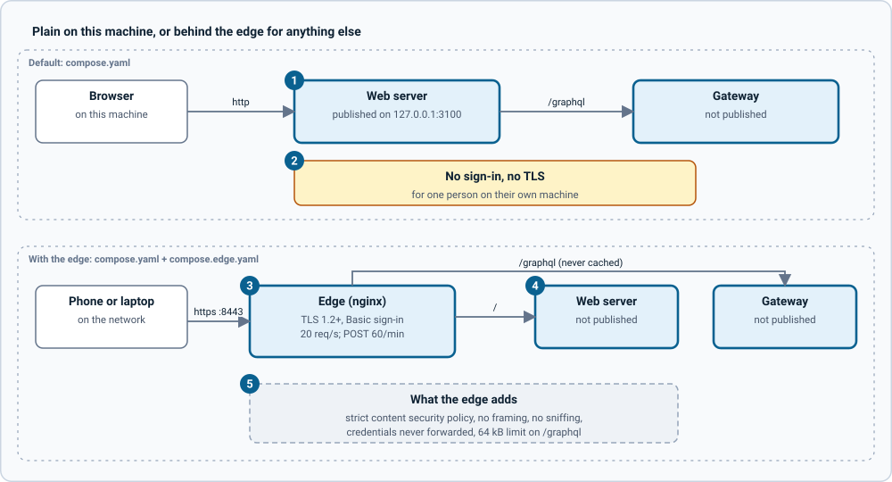

# Architecture of grandstack-web-aura

grandstack-web-aura is a mobile-friendly web UI for managing Neo4j Aura, built as a GRANDstack setup rather than beside one. A local Neo4j database **caches Aura's state**, so screens read from Neo4j and not from the Aura API. The Aura REST API (v1) is used to sync that state in and to apply changes a person has reviewed and confirmed. Everything is served as one federated GraphQL supergraph.

It uses the other repositories for what they already do:

| Repository | What it provides here |
| --- | --- |
| `grandstack-server` | The GraphQL API over Neo4j. Run with `MODEL=aura` it serves this repository's graph model, twice: read-only (`READ_ONLY=true`) and writable. There is no server code in this repository |
| `grandstack-federation` | The gateway image. This repository mounts its own `supergraph.graphql` and `gateway.config.ts` into it, the way that repository's own setup does for Wikipedia |
| `grandstack` | The compose files: `compose.aura.yaml` (and `compose.aura-edge.yaml`) run the whole setup beside the others |
| `grandstack-web-aura` (this one) | The graph model, the Aura subgraph, mock-aura, the web app, the optional edge, and the gateway's config files |

Applies to grandstack-web-aura v0.0.1 with grandstack-server (the version that adds `MODEL` and `READ_ONLY`), React 19, Vite 8, urql 5, `@neo4j/graphql` 7 on Apollo Federation 2, Hive Gateway 2 and TypeScript. The design decisions and the build history are in [PLAN.md](../PLAN.md); this page describes what exists.

## Stack

| Concern | Choice | Notes |
| --- | --- | --- |
| UI | React 19 + react-router 8 | Client-side routes; nginx falls back to `index.html`. |
| GraphQL client | urql 5 with `cacheExchange` and `fetchExchange` | Cache-and-network, so lists follow the store. |
| Types | GraphQL Code Generator, client preset | Typed operations are committed under `web/src/graphql/generated`. |
| Store | `grandstack-server` (`@neo4j/graphql` 7, graphql-yoga) | Serves the graph model in `models/aura`. Two instances from one image and one model: read-only (`READ_ONLY=true`) and writable. |
| Aura subgraph | `@apollo/subgraph`, graphql-yoga | Plans, confirms, runs changes, reveals passwords, checks drift. Owns the encryption key. |
| Gateway | Hive Gateway (the `grandstack-federation` image), composed with `mesh-compose` | `gateway/supergraph.graphql` is generated and committed, and mounted into the image. |
| Database | Neo4j 2026.10 (community) | The cache, plus history and sealed secrets. |
| Edge (optional) | nginx | TLS, Basic sign-in, rate limits, security headers. |
| Fake Aura | `mock-aura` | A fake of the Aura API, checked against Aura's own OpenAPI file. |
| Styling | Plain CSS with design tokens | `web/src/theme/tokens.css`, light, dark and follow-the-system. |
| Images | None | Posters and initials are generated in the browser. |

## The parts

| Part | What it is | Port (when published) |
| --- | --- | --- |
| `server` | `grandstack-server`, `MODEL=aura`, `READ_ONLY=true`, a federation subgraph. The gateway and the web app read through it | 4001 (4000 inside) |
| `store-writer` | The same image and model, writable. Only the Aura subgraph uses it | none |
| `aura` | The Aura subgraph: REST client and token manager, sync, sealed secrets, operations | 4010 |
| `mock-aura` | A fake Aura API for development and tests | 4020 |
| `gateway` | Hive Gateway with this repository's supergraph and config | 4000 |
| `web` | The React app, served by nginx, which also forwards `/graphql` | 3000 |
| `edge` | Optional nginx in front of everything | 8443 |

[](diagrams/system-overview.svg)

*Figure: the parts and who talks to whom. Click the image for full size; the numbered notes below carry the same information as text.*

1. **The edge is optional.** With `compose.aura-edge.yaml` it is the only way in, over TLS with a sign-in. Without it the browser talks plain HTTP to the web server on the same machine.
2. **The web server serves the app and forwards `/graphql`** to the gateway, so the app and its data share one origin in both modes. There is no CORS to get wrong, the browser sends its sign-in itself, and the page's content security policy can allow nothing but its own origin.
3. **The gateway composes two subgraphs** into one supergraph: the read-only server (named `Neo4j`, as in `grandstack-federation`) and the Aura subgraph. It is `grandstack-federation`'s image with this repository's `supergraph.graphql` and `gateway.config.ts` mounted over its own. Its browser query editor is turned off.
4. **The read-only server** is `grandstack-server` with `READ_ONLY=true`: the schema has no `Mutation` type at all. It is a federation subgraph, with `Instance` keyed on `auraId`.
5. **The writable server** is the same image and model without `READ_ONLY`. It publishes no port and sits on a private network shared only with Neo4j and the Aura subgraph, so nothing else can ask it to change data. It has no sign-in of its own: the network is what keeps others out.
6. **The Aura subgraph is the only thing that talks to Aura**, and the only thing that holds the key that seals secrets. All writes to Aura happen in its reconciler, after a confirm. It writes the store through the writable server.
7. **Neo4j holds the cache and the sealed secrets.** The secrets are nodes (`AuraSecret`, `InstanceCredential`, `AuditEvent`) that are not in the GraphQL schema; the Aura subgraph reaches them over Bolt.
8. **What is published** is decided by the compose files in the `grandstack` repository: the web server and gateway on this machine only by default, the edge alone with `compose.aura-edge.yaml`, and never the writable server.

## Folder map

```
models/aura/
  schema.graphql             the graph model, with descriptions on every type and field
  setup.cypher               uniqueness constraints and indexes, run by the server at every start
  model.json                 { "refreshCounts": false }: the Movies counts plugin is off
aura/
  src/client.ts              the Aura REST client: token, retries, Retry-After, 409, 404
  src/sync.ts                Aura into the store: tenants, options, instances
  src/service.ts             connect, disconnect, sync now, reveal a password, check against Aura, the sync timer
  src/crypto.ts, secrets.ts  AES-256-GCM sealing, and the secret nodes over Bolt
  src/schema.ts              the Aura subgraph's GraphQL
  src/storeClient.ts         talks to the writable server
  src/operations/            plan, confirm, run, recover: state.ts, diff.ts, plan.ts, run.ts, service.ts, store.ts
  src/generated/             types from the OpenAPI file (never edit)
mock-aura/
  src/                       the fake API, its seed data, and its test controls (/__faults, /__passwords)
gateway/
  gateway.config.ts          upstream addresses and options, mounted into the federation gateway image
  mesh.config.ts             how the supergraph is composed from the running subgraphs
  supergraph.graphql         GENERATED by `npm run compose:supergraph`; commit it
web/
  src/pages/                 one component per route
  src/lib/                   pure logic with unit tests: filters, status, format, changes, create, operations, theme
  src/ui/                    buttons, chips, modal, instance card, password field, icons
  src/graphql/documents.ts   every operation; typed output in src/graphql/generated (committed, never edit)
  default.conf.template      the web server's nginx config, including the /graphql forward
  e2e/run.mjs                real-browser checks
edge/
  default.conf.template      the nginx server block, filled in from the environment
  security-headers.conf      one set of headers, shared with the web server
  check.mjs                  checks of what the edge promises
docs/
  aura_api_spec_v1-2.yaml    the real Aura API spec, the source of truth for the REST API
scripts/init-env.sh          writes SECRET_KEY into ../grandstack/.env, and with --edge the certificate and sign-in
```

The compose files are **not here**. They are `compose.aura.yaml` and `compose.aura-edge.yaml` in the `grandstack` repository, which builds this repository's `aura/`, `mock-aura/`, `web/` and `edge/` from the sibling folder and mounts `models/` and `gateway/` into the server and gateway.

## The graph model

Observed state is separate from intent. `Instance` is what Aura said; `Operation` is what a person asked for.

```
(:AuraAccount)-[:HAS_TENANT]->(:Tenant)-[:HAS_INSTANCE]->(:Instance)
(:Tenant)-[:OFFERS]->(:InstanceConfiguration)      what the tenant may create: cloud, region, tier, size, version
(:Instance)-[:ON_CLOUD]->(:CloudProvider)           tags for filtering
(:Instance)-[:HAS_TIER]->(:Tier)
(:Instance)-[:HAS_CREDENTIAL]->(:InstanceCredential)    sealed password; not in GraphQL
(:Operation)-[:TARGETS]->(:Instance)                absent until a create has made one
(:Operation)-[:HAS_STEP]->(:OperationStep)          six steps, shown as progress
(:SyncRun)                                          one per sync, with counts and an outcome
```

- **Instances Aura no longer lists are kept.** They get `deletedInAuraAt`, so history survives; the interface shows them as removed.
- **Timestamps are ISO 8601 UTC strings with milliseconds**, not the `DateTime` scalar, which needs the APOC plugin. Milliseconds stop two runs in the same second tying.
- **`Instance.version` is usually empty.** Aura's instance details do not carry the Neo4j version; only instances created here record one.
- The full model, with every property, is in `models/aura/schema.graphql` and [PLAN.md](../PLAN.md#5-graph-model).

## Routes

| Path | Page | Purpose |
| --- | --- | --- |
| `/` | Home | Hero search, tag chips with counts, rows of cards ("Needs attention", "Running"), New instance |
| `/instances` | Results | The gallery with filters in the URL |
| `/instances/new` | Create | The create stepper |
| `/instances/:id` | Detail | Connection (with the password eye), properties, check against Aura, actions, changes made here |
| `/instances/:id/edit` | Edit | Name, size, switches; asks for a plan |
| `/operations` | Operations | Every change, with state filters |
| `/operations/:id` | OperationPage | Review, then progress, then the result |
| `/account` | Account | The connection, stored-copy counts, recent syncs, replace credentials, disconnect |

Before an account is connected, the app shows only the connect form; after credentials are stored but before the first sync finishes, it shows the first-sync screen.

## Data flow

Three kinds of data move, and they take different paths:

1. **Reads** go browser, web server, gateway, read-only server, Neo4j. They never touch Aura. A sync (every 15 minutes, or on Sync now) refreshes what they read.
2. **Changes** go browser, web server, gateway, Aura subgraph, and then the writable server and Aura. A plan writes an `Operation` and returns its id; a confirm starts the reconciler; the browser then reads the operation and its steps like any other data. See [features](features.md#plan-review-confirm).
3. **Secrets** go browser, gateway, aura subgraph, Bolt. The client secret is write-only. An instance password leaves the store through exactly one mutation, `revealInstancePassword`. See [features](features.md#showing-a-stored-password).

State that a person might want to share or reload lives in the **URL** (the gallery's filters, the page you are on). The only browser-stored state is the theme choice.

## Caching and freshness

The urql client uses `cache-and-network`: pages show cached data at once and always refetch. Pages also refetch when a sync finishes (`useRefreshOnSync`). An operation in progress is polled every 1.5 seconds; the connection state is polled every second while a sync runs and every 30 seconds otherwise. Reading never calls Aura, so the number of people using the app does not change Aura's load.

## Security model

- **The Aura client secret** is sealed with AES-256-GCM, with the owner bound in as authenticated data, so a copied value will not open on another record. It is stored as a node over Bolt, never returned by any query, log or error, and read only for the call that needs a token.
- **Instance passwords** are sealed the same way, with the instance id as the owner, and stored the moment Aura returns them (it returns them once). Every reveal is recorded before the password is returned.
- **The key** is `SECRET_KEY` (32 bytes, base64). Values record the key version that sealed them. Losing the key means the sealed values cannot be opened.
- **The writable server is reachable only from the Aura subgraph**, by network, because the stock server has no token of its own.
- **Nothing reaches Aura without a confirm**, and a delete also needs the instance's name typed, checked on the server.
- **Network exposure** is a deployment choice, shown below.

## Build and deploy

Every image is pinned to an exact version **and** a digest. The web image builds the app and serves it with unprivileged nginx on port 8080; the edge image adds nothing but configuration. `VITE_GRAPHQL_URL` is empty, so the app calls `/graphql` on its own origin, where the web server (or the edge) forwards it to the gateway. The compose files that run all of this are in the `grandstack` repository.

[](diagrams/deployment-modes.svg)

*Figure: the two ways to run it. Click the image for full size; the numbered notes below carry the same information as text.*

1. **The default publishes the web server and the gateway**, on `127.0.0.1` only (ports 3000 and 4000), over plain HTTP.
2. **There is no sign-in and no TLS in that mode.** It is for one person on their own machine. `WEB_BIND=0.0.0.0` would open it to the network with nothing in the way.
3. **The edge** (`compose.aura-edge.yaml`) adds TLS 1.2+, an HTTP Basic sign-in from a bcrypt list, 20 requests a second per address, and 60 POSTs a minute (the changes). It refuses to start without a certificate and a hashed sign-in list.
4. **Behind the edge nothing else is published.** The overlay uses compose's `!reset` to remove the ports of the web server, gateway, subgraphs, mock-aura and Neo4j.
5. **The edge adds** a strict content security policy, no framing, no sniffing, no referrer, `no-store` on GraphQL answers (one may hold a password), a 64 kB body limit on `/graphql`, and it never forwards the sign-in to the upstreams.

How to set up each mode, serve a phone, and what the sign-in does and does not protect: [deploying.md](deploying.md).

Next: [features](features.md), [customising](customising.md), [recipes](recipes.md), [testing](testing.md).
