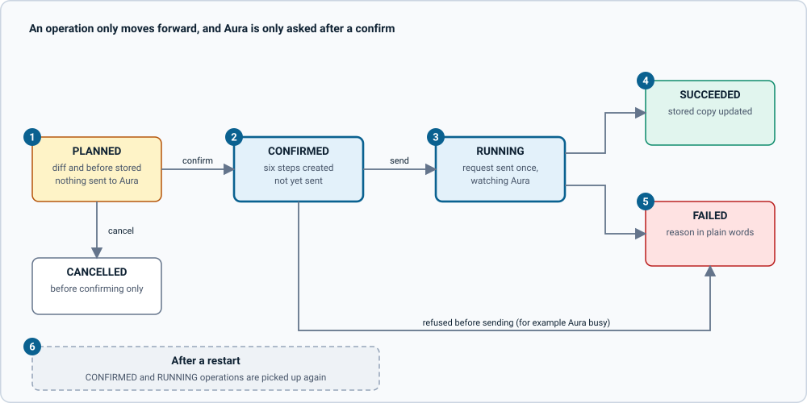

# How the features work

Each section says what the person sees, where the code is, and the one non-obvious thing. Facts here were checked against the running app, including a read-only run against a real Aura account.

## Connecting an account and the first sync

Code: `web/src/pages/Setup.tsx`, `aura/src/service.ts` (`connect`), `aura/src/client.ts`, `aura/src/sync.ts`.

- The first screen asks for the Aura client ID and secret. The secret field is cleared after every attempt, success or not, and is kept nowhere in the browser.
- `connectAura` fetches a token with the credentials **first**. If Aura refuses them, nothing is stored and the message says so. Only then is the secret sealed and stored, the account recorded, and a first sync started.
- The first-sync screen shows progress, or the error if the sync failed.
- **The token flow** is `POST /oauth/token` with Basic auth and `grant_type=client_credentials`. The token is cached and renewed 60 seconds before it expires, requests that start together share one refresh, and a 401 or 403 from the API gets one fresh token and one retry.
- **Non-obvious:** the secret is not held in memory between token fetches. The client takes a `credentials()` function that reads and opens the sealed value only when a token is needed.

## Sync

Code: `aura/src/sync.ts`, `aura/src/service.ts`.

- A sync reads the tenants, each tenant's instance options, the instance list and then each instance's details, and writes the store through the writable server. It runs at start-up when an account is connected, every 15 minutes (`SYNC_INTERVAL_MS`), and on **Sync now**. Only one runs at a time.
- Each run is recorded as a `SyncRun`: SUCCEEDED, SLOWED when Aura asked it to wait, or FAILED with a plain-words reason. A failed run keeps what the store already had.
- It is idempotent. An instance Aura no longer lists is marked `deletedInAuraAt` once and kept.
- **Non-obvious (list is a summary):** `GET /instances` returns only id, name, tenant, cloud and created time. Status, size and the rest need one `GET /instances/{id}` each, so a sync costs one request per instance plus a few. A real account with three tenants and one instance syncs in about 13 seconds and 7 requests.
- **Non-obvious (the store has no `neq`):** the store's v7 filters have no "not equal". Code that needs "not X" uses `NOT` or tests the value it means.
- **Non-obvious (links are not idempotent):** connecting a relationship that already exists adds a second link. The sync only connects on create or on a real change, and moves a tag by disconnecting the old one and connecting the new one in two statements.
- **Non-obvious (real Aura differs from its spec):** `graph_nodes` and `graph_relationships` are documented as strings and arrive as numbers. They are stored as text whichever arrives. See [testing](testing.md#real-aura-and-its-spec).

## The gallery (`/` and `/instances`)

Code: `web/src/pages/Home.tsx`, `Results.tsx`, `web/src/FilterPanel.tsx`, `web/src/lib/filters.ts`, `web/src/ui/InstanceCard.tsx`.

- Home is a hero with a search box, tag chips for tenant, cloud and tier (each with a count), and rows of cards. Results is the full list with a sidebar of filters on a wide screen and a bottom sheet on a phone, removable chips, and a sort (name, newest, needs attention first, largest first).
- **Filters live in the URL** (`q`, `t` tenant, `c` cloud, `tier`, `st` status group, `rm` show removed, `s` sort), so a view can be shared, reloaded and used with the back button. `parseFilters` and `serializeFilters` are pure functions with unit tests.
- **Counts leave out their own filter.** `buildWhere(filters, facet)` builds the filter without one facet, which is how each option shows how many instances it would give. Counts also use the "not removed" filter, or they would count instances Aura no longer lists.
- **Sorting is in the browser.** Memory is text in the store (`"16GB"`), so it cannot be sorted by the database.
- Posters are generated from the name and the cloud (`web/src/lib/poster.ts`); there are no image files.

## The instance page (`/instances/:id`)

Code: `web/src/pages/Detail.tsx`, `web/src/ui/PasswordField.tsx`.

- Status, tags, the connection card, properties, a **Stored copy** card with Check with Aura, and the changes made here. Actions (Edit, Pause or Resume, Delete) sit in a bar that is sticky on a phone.
- **Actions lock** while Aura is working on the instance (any of the 13 statuses that group as in progress) or while a change of ours is confirmed or running. A banner links to the active change. This matches Aura answering 409 to a second operation.
- An instance Aura no longer lists shows a "no longer in Aura" banner and no actions.
- Free instances have no storage, no version and no secondaries; the page leaves those rows out.

## Plan, review, confirm

Code: `aura/src/operations/` (`plan.ts`, `diff.ts`, `service.ts`, `run.ts`, `state.ts`, `store.ts`), `web/src/pages/OperationPage.tsx`.

A change is never sent when it is asked for. The person asks for a **plan**, reviews it, and confirms it.

*Figure: the life of a change. Click the image for full size; the numbered notes below carry the same information as text.*

1. **Planning writes and sends nothing.** `planUpdate`, `planPause`, `planResume`, `planCreate` and `planDelete` check the request against the store, then record an `Operation` in PLANNED with the wanted state, the instance as it was (`before`) and a plain-words `diff` with warnings. They return only an id.
2. **Confirming** is one atomic query that moves the operation from PLANNED to CONFIRMED, after three checks: the instance is the same as when it was planned (fields are compared, not `syncedAt`, because a sync that changed nothing must not invalidate a plan), nothing else is confirmed or running for it, and for a delete the typed name matches. A per-instance lock stops two confirmations passing the checks together.
3. **Running sends once.** The change is sent to Aura exactly once and is never retried after a 5xx or a lost connection, because it may have been applied. Reads are retried.
4. **Done means the instance shows it.** The reconciler polls `GET /instances/{id}` until the status is stable **and** the values match what was asked. A rename that Aura accepts but has not yet applied is not done. A delete is done when Aura answers 404, not when the status reads "destroying".
5. **Failures are in plain words.** A refusal from Aura (for example 409, Aura is already working on it) shows Aura's reason, and the page offers Sync now. A timeout (30 minutes by default) says the change may still finish.
6. **After a restart,** CONFIRMED and RUNNING operations are picked up again by what had happened. Not yet sent: send it. Sent and answered: only watch. Possibly sent: look at Aura; if it already shows the change, finish; otherwise fail and say so, rather than send a second time.

*Figure: one change from plan to finished. Click the image for full size; the numbered notes below carry the same information as text.*

1. **The plan is a stored operation.** Review, cancel and confirm all refer to its id, so the review the person saw is the plan that runs.
2. **Compare, then move.** A plan made from an instance that has since changed is refused ("This instance changed after you planned this. Plan the change again").
3. **The send is one request.** PATCH for an edit (Aura answers 200 if applied at once, 202 if carried out in the background), POST for create, pause and resume, DELETE for a delete.
4. **Polling backs off.** Waits start at 3 seconds and grow by 1.4 times to a 15 second ceiling. Three failed looks in a row stop the change with "lost contact"; one bad moment does not.
5. **The stored copy is refreshed** from what Aura just reported, so the instance page is right without waiting for a sync.
6. **The page follows the operation.** `OperationPage` reads the operation and its six steps every 1.5 seconds while it is CONFIRMED or RUNNING, so leaving and coming back, or reloading, picks it up.

The six steps are: Change confirmed, Request sent to Aura, Accepted by Aura, Waiting for Aura to finish, Updating the stored copy, Done. `requestedBy` is "local" until there is more than one user.

## Edit (`/instances/:id/edit`)

Code: `web/src/pages/Edit.tsx`, `web/src/lib/changes.ts`, `aura/src/operations/plan.ts`.

- Name (1 to 30 characters, with a counter that counts characters, not bytes), memory and storage, and the vector-optimized and graph-analytics switches. **Review changes** stays off until something differs.
- **Memory and storage are chosen as a pair**, from the sizes the instance's tenant is offered for its cloud, region and tier, read from the store. The current pair is marked. The server refuses any pair that is not offered.
- Only what changed is sent. An untouched field is never in the request.
- Only a running instance can be edited. A paused one says to resume it first.

## Pause and resume

Code: `web/src/pages/Detail.tsx`, `aura/src/operations/run.ts`.

- Pause shows only for a running instance, Resume only for a paused one. Both go through plan, review and confirm, like every change. The pause review warns that connections will fail while it is paused.
- "Done" for a pause is the status `paused`; for a resume, `running`.

## Create (`/instances/new`)

Code: `web/src/pages/Create.tsx`, `web/src/lib/create.ts`, `aura/src/operations/plan.ts` (`normaliseCreate`).

- Five steps, one decision each: tenant, cloud, region and tier, size, name and options. With one tenant the first step is skipped. Tenant and cloud are lists of buttons; **region, tier and size are drop-downs**, because a real tenant offers a dozen regions and many sizes. Each drop-down starts with an entry that says what to do ("Choose a region"), the tier waits for a region ("Choose a region first"), and Continue stays off until a choice is made.
- **Every list comes from the chosen tenant's stored options**, and choosing something earlier clears what depended on it (`choose` in `lib/create.ts`), so the form cannot hold a combination Aura would refuse. The server checks the combination again at plan time and again at confirm, because a sync may have changed what is offered.
- **Only the chosen tenant's options are read,** once it is chosen. A real tenant offers about 3,000 combinations; reading every tenant's in one query was 1.5 MB.
- The plan fills in the storage, version and region name from the offered option. The review shows only new values (there is no "before"), warns that creating can change what you are billed (this app does not know your plan), and says the password is stored.
- A create is never sent twice. See "Aura shows the password once" below for what happens to the password.

## Delete

Code: `web/src/pages/OperationPage.tsx`, `aura/src/operations/service.ts` (`confirm`).

- Delete plans like any change. The review says it cannot be undone and asks for the instance's name, typed **exactly** (case matters). The button stays off until it matches, and the server checks the name too, so a script cannot skip the page.
- When Aura answers 404, the record stays, marked as removed, and the stored password is deleted with it. Cancelling a delete sends nothing.
- Delete is allowed for any instance Aura is not already working on, including a paused or failed one.

## Showing a stored password

Code: `aura/src/service.ts` (`revealPassword`), `aura/src/secrets.ts`, `aura/src/operations/run.ts` (`sendCreate`), `web/src/ui/PasswordField.tsx`.

*Figure: where an instance password goes and how it comes back. Click the image for full size; the numbered notes below carry the same information as text.*

1. **Aura returns the password once,** in the create answer. Nothing else can recover it.
2. **It is sealed and stored first,** before the instance is recorded or any step is marked: AES-256-GCM, with the instance id as the owner, as an `InstanceCredential` node written over Bolt.
3. **Then the instance is recorded** with its tenant, cloud and tier, the operation is linked to it, and the credential is linked.
4. **If the password cannot be stored,** the change fails and says so ("Aura will not show it again"). If the instance cannot be recorded, the password stays stored and the message says to sync.
5. **Showing it records first.** `revealInstancePassword` opens the sealed value (a wrong key or a value moved to another instance fails), then records the count, the time and an `AuditEvent`, and only then returns it. A reveal that cannot be recorded does not happen.
6. **The page shows it for 30 seconds** or until the tab is hidden, with a copy button, and never writes it to storage or the URL. Nothing selects it on load; the eye is the only trigger.

- An instance found by a sync has no stored password, because Aura never gave this app one. The page says so.
- `revealInstancePassword` is the only field in the whole supergraph that can return a password. A test fails if another appears.

## Check with Aura

Code: `aura/src/service.ts` (`checkInstance`), `web/src/pages/Detail.tsx`.

- **Check with Aura** asks Aura now and lists what differs from the stored copy (name, status, size, switches), stored against Aura. It changes nothing. **Sync now** then brings the copy up to date.
- A value Aura does not report is not a difference. If Aura answers 404 the page says it no longer has the instance.
- This replaces the federated `live` field the first design had: a query that reads Aura only when asked needs no entity extension.

## Operations (`/operations`)

Code: `web/src/pages/Operations.tsx`.

- Every change made through this app, newest first, with state chips (All, Active, Planned, Failed) and how long each took. Each row opens its operation page. An operation planned and never confirmed stays "Planned, not sent" until it is cancelled.

## Account (`/account`)

Code: `web/src/pages/Account.tsx`.

- The connection (the client ID with its middle hidden, never the secret), counts of what is stored, the options per tenant, recent syncs with their outcome, Sync now, **Replace credentials** (checked with Aura first; a wrong replacement leaves the connection as it was) and **Disconnect**.
- **Disconnect deletes the stored client secret and stops syncing, and keeps instances, stored passwords and history.** Nothing changes in Aura. Connecting again resumes, and duplicates nothing.
- **Reset the stored copy** (in the stored-copy panel) removes what came from Aura and reads it in again, after a confirmation that says what goes and what stays. Use it when the stored copy looks wrong, or after the model changed. It asks Aura for nothing but the usual sync, and changes nothing in Aura.
  - **Removed:** the tenants, their instance options, and the instances Aura still lists.
  - **Kept:** the Aura credentials (so no new sign-in is needed), every past operation and its steps, the passwords stored for instances made here (Aura shows them once, so they cannot be read again), the cloud and tier tags, the sync history, and any instance Aura no longer lists (a record of what was deleted, which Aura cannot give back).
  - **How the links survive:** before deleting, each operation notes which instance it pointed at and each kept instance which tenant it was in; after every sync the links are put back (`relinkAfterReset`), and stored passwords are re-attached to their instances by id. A reset that was cut short is repaired by the next sync.
  - **While it runs** the account's last-sync time is cleared, so the app shows the first-read screen until the new read finishes. It is refused while a sync or a change is under way, and when no account is connected.

## Status model

Code: `aura/src/status.ts`, `web/src/lib/status.ts`.

- The 13 statuses in Aura's spec group as READY (running), STOPPED (paused, suspended), IN_PROGRESS (creating, updating, pausing, resuming, suspending, loading, restoring, overwriting, destroying) and FAILED (loading failed). Every status is shown as an icon and a word, so colour is never the only signal.
- **A status the spec does not list is treated as in progress**, shown in its own words, so Edit, Pause and Delete stay locked until it is understood. The spec lists `suspended` and `loading` without explaining them, so the app shows them without a reason.

## Themes

Code: `web/src/lib/theme.ts`, `web/src/theme/tokens.css`.

- Light, dark, or follow the system, remembered in `localStorage` and applied before the first paint so there is no flash. Every text and background pairing is chosen to stay above 4.5:1.

Next: [customising](customising.md), [recipes](recipes.md), [testing](testing.md).
